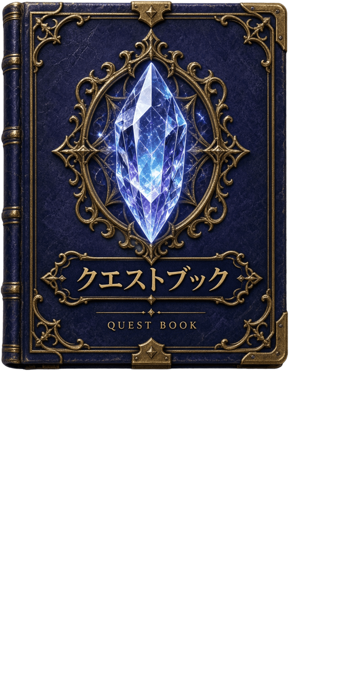

# Journal 0.3.4 by Kxteel [jpver 0.3.0 by Tsukasa]

ファイナルファンタジーXIで、ミッションとクエストの内容を日本語で見るためのアドオンです。手順、ピン留め、通知、コンパスを、ゲームの中から開けます。説明・画像・通知音・フォントをまとめて入れてあるので、英語版を別に入れる必要はありません。

英語やスペイン語で使いたいときは、Kxteel氏のオリジナルを使ってください。この日本語版に言語の切り替えはありません。オリジナルの配布先はこの説明には載っていないので、ここには書きません。英語の説明は [Journal/docs/UPSTREAM_README.md](docs/UPSTREAM_README.md) にあります。

## 必要なもの

- Windows版のFFXIと、Ashita v4で動くホストです。ホストに入っている共通ライブラリを使います。このアドオンにはコピーしていません。
- 文字は、Windowsに入っているメイリオを使います。メイリオ自体は同梱していません。メイリオが無いときは同梱のフォントに切り替わりますが、そのときは日本語が欠けることがあります。欠けたらメイリオに戻してください。
- ここに同梱している「あずきフォントLP」の作者は日向梓です。公式は https://azukifont.com/ です。フォントの許諾は変えていません。

VanaCoreは、Ashitaと同じ呼び出しができる場合に使う想定です。すべての版で動くとは限りません。画面の出方は環境によって違います。

## 初めて入れる

1. ZIPを展開し、中の **Journalフォルダごと** をホストの addons に置きます。`addons/Journal/journal.lua` になっていれば正しく置けています。Journalの中に、もう一度Journalを作らないでください。
2. ゲーム内で `/addon load journal` と入力します。毎回自動で読み込む設定は、お使いのホストの説明に従ってください。
3. `/journal settings` で設定を開き、音量、文字の大きさ、フォント、閉じたときのアイコンを好みに合わせます。

## いま入っているものと入れ替える

古いフォルダの上から混ぜて上書きしないでください。次の順番です。

1. `/addon unload journal` で止めるか、ゲームを終了します。
2. いまの Journal フォルダを、addons の外へコピーして残します。自分で足したフォントや音も、一緒に残してください。
3. アドオンの外にある設定も、コピーして残します。Ashitaでは、多くの場合 `config/addons/Journal/` にキャラクターごとの設定があります。場所が違うホストでは、実際の保存先を確認してください。この設定フォルダは消さないでください。進み具合もここに残ります。
4. バックアップを開けることを確認してから、**addons の中の古い Journal フォルダだけ** を消します。FFXI本体、ほかのアドオン、config フォルダ全体は消さないでください。
5. 新しい Journal フォルダを addons に置き、`/addon load journal` で読み込みます。自分で足していたファイルは、問題がないことを確認してから戻します。古いプログラム一式は戻さないでください。
6. うまくいかないときは、読み込みを止めて新しい Journal を外し、残しておいた古いフォルダを戻します。設定は、必要なときだけバックアップから戻します。

この説明は手順の案内です。こちらからあなたのPCのファイルを消したり変えたりはしません。

## 今回増えたこと

- ミッションとクエストの一覧に、進み具合が分かる小さな絵が出ます。絵のファイルが無いときは、今までどおり丸印です。
- トラッカーや通知、コンパスに並ぶクエストにも、同じ絵が出ます。
- 近くのクエストをコンパスへ出す範囲が、少し広くなりました。
- コンパスやトラッカーからクエストを開くと、そのクエストの詳細だけが開きます。詳細の窓の大きさは、アドオンを読み直すまで覚えています。
- 繰り返せるクエストは、終わったあとでも印が残ります。
- クエストの欄に CatsEye を足しました。Horutoto Hakken の手順を日本語で読めます。進行の印は付きません。

矢印が指す位置の計算は、これまでと同じです。

## 使い方

- `/journal` でミッションを開きます。
- `/journal quest` でクエストを開きます。
- `/journal pin` で、ピン留めした項目を追う小さな窓を出したり隠したりします。開いている項目は `/journal pin add` でピン留めできます。
- `/journal settings` で設定を開きます。
- ほかの操作は `/journal help` で一覧できます。

星唄の「1-10」の名前と手順も日本語で出ます。同じ英語名の別の節は、それぞれの日本語名で出ます。地名や人の名前など、一部は英語のまま残ることがあります。

黄色いアイテム名をクリックすると、その名前だけをコピーします。文章中のすべての単語や、一覧の全部がコピーできるわけではありません。

新しいミッションやクエストの通知では、「はい」「いいえ」でピン留めするかを選べます。いつもの操作は「ピン留め」です。

## 設定でよく変えるところ

- 文字の大きさは、Journal本体が 50% から 140%、トラッカーが 50% から 200% です。別々に変えられ、途中の数値も保存されます。トラッカーの文字を大きくしても、窓の幅は変わりません。入りきらない行は折り返します。
- トラッカーの窓の大きさは、設定の「窓のサイズ（表示エリア）」、または `/journal pin size` で 0.60倍から 2.00倍です。変わるのは窓の幅だけで、文字の大きさは変わりません。
- トラッカーの「太字」をオンにすると、トラッカーの文字が太字になります。太字のフォントが無いときは、文字を少しずらして重ね描きします。
- 「重ね表示の高さ上限」で、重ね表示のトラッカーが伸びる高さを 200px から 960px のあいだで決められます。上限を超えた分は、トラッカーの上でホイールを回すと見られます。最初は「無制限」です。
- タブ表示でタブが窓に入りきらないときは、左右の `<` `>` を押すか、タブの上でホイールを回すと横に送れます。選んだタブは自動で見える位置に来ます。
- フォントを変えたあとは、`/addon reload journal` で読み込み直してください。読み直すまで、画面の字体は変わりません。
- 設定の窓の大きさを変えると、次に開いたときもその大きさです。画面からはみ出すときは、画面の中に収まるように直します。
- 設定はキャラクターごとに保存されます。

## 閉じたときのクエストブック

Journalを閉じると、クエストブックの絵が出ます。クリックしてそのまま離すと開きます。少し動かしてから離すと、開かずにその場所を覚えます。大きさは設定で 64 から 128 のあいだで変えられます。最初は 96 です。「アイコンの位置を戻す」で、左上のほうへ戻せます。

## うまくいかないとき

- 日本語が欠けるときは、フォントをメイリオに戻して `/addon reload journal` してください。
- 入れ替えでおかしくなったときは、残しておいた古い Journal フォルダを戻します。設定フォルダは、消していなければそのままで使えます。
- 近くのクエストを知らせる音のファイルは入っていません。その通知は、音が鳴らないことがあります。

## 寄稿

トラッカーの表示は、hando（handomade）さんの寄稿です。 https://github.com/handomade

## ライセンス

Journalの原著作権は Copyright (c) 2026 Kxteel です。元のMIT許諾は [Journal/LICENSE](LICENSE) に原文のままあります。日本語版の表示は [jpver 0.3.0 by Tsukasa] です。プログラムの版番号は 0.3.4 です。

ソースをまとめた配布物は GPLv3 です。全文は [Journal/COPYING](COPYING) にあります。無保証で、条件に従えば見ること、変えること、再配布ができます。MIT、BSD、OFLの各通知は [Journal/THIRD_PARTY_NOTICES.md](THIRD_PARTY_NOTICES.md) と [Journal/licenses](licenses) に残しています。これらの通知は消さないでください。
