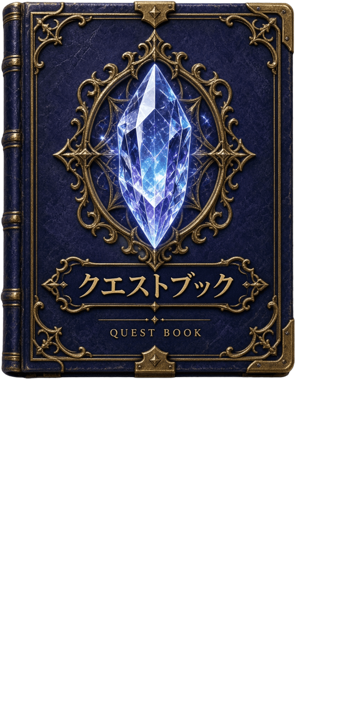

# Journal 0.3.0 by Kxteel [jpver 0.1.0 by Tsukasa]

> オリジナル版の別途導入が不要な、日本語専用の完全版です。あずきフォントLPとクエストブックアイコンも含みます。

2026-11-08変更の日本語派生版です。結合ソース配布はGPLv3（COPYING/CHANGES_JP.md参照）、原MIT/BSD通知とOFLフォント許諾を保持し、無保証でソースを改変・再配布できます。

日本語専用のFFXI Journal派生版です。**Journal本体・全データ・画像・通知音・OFLフォントを含み、オリジナル版の別途導入は不要です。** 差分更新ZIPではありません。ただしFFXI本体、Windows、対応するAshitaホスト/標準ライブラリは別途必要です。

英語・スペイン語で利用する方はKxteel氏のオリジナル版を使用してください。日本語版に言語選択はありません。元の配布URLは提供されたREADMEに記載がないため、無関係なリンクを原版URLとして記載しません。原版READMEはdocs/UPSTREAM_README.md、原著作権はLICENSEに保持しています。

## 前提と動作確認範囲
- Windows版FFXI＋Ashita v4互換環境。ホストに付属するcommon、d3d8、imgui、settingsとLuaJIT ffiを利用します。これらはこのアドオンに複製しません。
- VanaCoreは必要なAshita API互換性がある場合の利用を想定しますが、すべてのバージョンの互換性は保証しません。今回の完全版はゲーム/実GPUで実行していません。VanaCoreの実ロード通知も未確認です。
- Windowsメイリオを既定フォントとしてインストール済みの場所から参照します。メイリオ/Calibriのフォントファイルは同梱しません。メイリオがなければ同梱フォントに退避しますが、日本語を保証できません。

## 新規導入
1. ZIPを展開します。中にある **Journalフォルダ全体** をホストのaddons直下へ配置し、`addons/Journal/journal.lua`になるようにします。Journal/Journalと二重にしないでください。
2. `/addon load journal`で読み込みます。ホストの自動ロード設定は各ホストの説明に従ってください。
3. 設定を開き、通知音量、文字サイズ、フォント、閉じたアイコンを調整します。

## 既存のオリジナル/旧日本語版から差し替え
**オリジナルがある場合は、バックアップを確認したうえで旧Journalフォルダを削除し、この完全版のJournalフォルダへ差し替えてください。** 古いLuaを残す上書きマージは避けます。

1. Journalをアンロード（`/addon unload journal`）するかゲームを終了します。
2. 旧Journalフォルダ全体を、addons外の別の場所へコピーしてバックアップします。自分で追加したフォント・音源も含めて保管してください。
3. **アドオン外の設定もバックアップ**します。現在のAshita settings実装ではホストの`config/addons/Journal/`以下に、defaults/キャラクター別設定が保存されます。ホストによって配置が異なる場合は実際の設定保存先を確認してください。この設定フォルダは削除しません。
4. バックアップが読めることを確認してから、**addons内の旧Journalフォルダだけ**を削除します。FFXI本体、他アドオン、config全体は削除しません。
5. 新しいJournalフォルダをaddons直下へ配置し、`/addon load journal`で読み込みます。自分の追加資産は権利と互換性を確認してから戻します。古いLua一式を戻さないでください。
6. 問題があればアンロード後に新Journalを外し、バックアップした旧Journalへ戻します。設定も必要時だけバックアップから復元します。

この文書は手動手順の案内です。こちらからPCファイルの削除・変更はしていません。

## 日本語版の機能
- ミッション/クエスト/ガイド等7690訳。全533クエストを監査済みですが、未検証固有名詞・元の空データ等、一部英語が残ります。内部英語ID・座標・検出/検索用データは保持。
- 日本語エリア太字、認識できたアイテム黄色、NPCの色を維持。黄色アイテム名クリックで表示名だけをコピー。折り返し中も完全な名前をコピーします。すべての単語や一覧の全項目が対応するわけではありません。
- 新ミッション/クエスト通知の確認だけ「はい/いいえ」。通常の操作はピン留め/ピン留め解除。
- 文字サイズ50～140%、79%等も保持。フォントはassets/fonts直下TTF/OTF/TTC＋Windowsメイリオから選び、**フォント変更後は`/addon reload journal`**。
- 添付の「あずきフォントLP」を`assets/fonts/azukifontLP.ttf`に未改変で追加しました。作者:日向梓/AzusaT、公式https://azukifont.com/ 。提供者から公開同梱の確認済みとの申告を受けて含めています。原規約を保持し、フォント自体の許諾を変更しません。現行の表示本文はcmap照合で未収録0文字ですが、基礎グリフ範囲の一部等は未収録です。実ロード/実描画は未検証で、文字欠け時はメイリオに戻してください。自動日本語マージはしません。
- 閉じたアイコンはユーザー提供の透過「クエストブック」。64～128px（初期96）、縦横比維持。クリックして離すと開き、4px以上のドラッグは開かず位置保存。位置リセットあり。原画の透明余白だけ無損失処理し、描き足し/高画質化による細部生成はしていません。
- 認識可能な画面寸法で画面外を補正。API欠落時や画像/フォントロード失敗時は安全な退避を試みますが、実ゲームの全環境を保証しません。
- 通知音量・画面フィット・自動進行等を維持。近くのクエスト用nearby_quest.wavは元データに含まれず、この任意音源がない通知は無音/一度警告の元仕様です。ガイドは元のPhoenix固有内容でCatsEyeの実機確認を意味しません。

## ライセンスと出典
Journal原著作権:Copyright(c)2026 Kxteel、元MIT通知を保持。日本語版表示:[jpver 0.1.0 by Tsukasa]。結合ソース配布はGPLv3、元のMIT/BSD通知と独立したOFLフォントの許諾は保持します。詳細はTHIRD_PARTY_NOTICES.mdとlicensesを参照。

この候補には個人の設定、履歴、ログ、キャッシュ、認証情報、保守用の私的パス入り資料を含めません。74Luaコンパイル、依存/資産参照/旧機能モック、アーカイブ整合性は検査しますが、実ゲーム・GPUロード・ホスト通知は未実行です。
